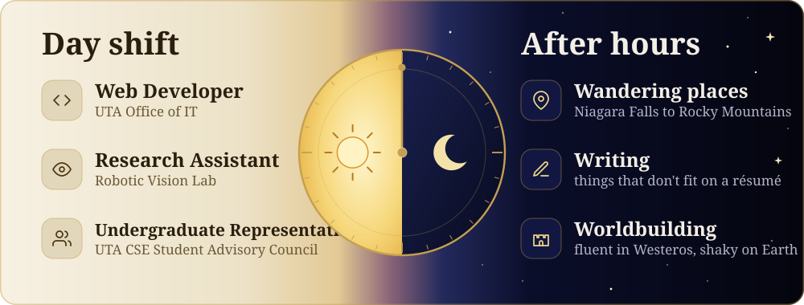

<div align="center">

<picture><source media="(max-width: 760px)" srcset="assets/hero-m-dark.svg"></picture>
<picture><source media="(max-width: 760px)" srcset="assets/hero-m-light.svg"></picture>

<a href="https://www.ashzaeen.com/"></a>&nbsp;<a href="mailto:afk6801@mavs.uta.edu"></a>&nbsp;<a href="https://www.linkedin.com/in/ashzaeen"></a>&nbsp;<a href="https://devpost.com/ashzaeen"></a>

</div>

With product thinking at my core, I care about why something exists and just as much about whether the last button works. Lately that means a finance app that taps you on the shoulder at checkout, glasses that read a car and write the listing, tools that take the pain out of web publishing for a university IT office, and an Android app that looks in your fridge and suggests dinner. It all started in 2022 with a GitHub bio that said “Dipping my toes into Python...” Two hackathon wins and a conference poster later, it has gone slightly better.

<picture><source media="(max-width: 760px)" srcset="assets/daynight-m.svg"></picture>

<picture><source media="(max-width: 760px)" srcset="assets/sky-1-m-dark.svg"></picture><picture><source media="(max-width: 760px)" srcset="assets/sky-1-m-light.svg"></picture>

<picture><source media="(max-width: 760px)" srcset="assets/h-achievements-m-dark.svg"></picture>
<picture><source media="(max-width: 760px)" srcset="assets/h-achievements-m-light.svg"></picture>

<picture><source media="(max-width: 760px)" srcset="assets/achievements-m-dark.svg"></picture>
<picture><source media="(max-width: 760px)" srcset="assets/achievements-m-light.svg"></picture>

<picture><source media="(max-width: 760px)" srcset="assets/sky-2-m-dark.svg"></picture><picture><source media="(max-width: 760px)" srcset="assets/sky-2-m-light.svg"></picture>

<picture><source media="(max-width: 760px)" srcset="assets/h-builds-m-dark.svg"></picture>
<picture><source media="(max-width: 760px)" srcset="assets/h-builds-m-light.svg"></picture>

<div align="center"><picture><source media="(max-width: 760px)" srcset="assets/card-cortex-m-dark.svg"></picture><picture><source media="(max-width: 760px)" srcset="assets/card-cortex-m-light.svg"></picture><br/><a href="https://github.com/ashzaeen/Cortex" title="Cortex on GitHub"></a><a href="https://devpost.com/software/cortex-tjmd8k" title="Cortex on Devpost"></a><a href="https://cortex-dashboard-seven.vercel.app" title="Cortex live dashboard"></a><picture><source media="(max-width: 760px)" srcset="assets/blank.svg"></picture><picture><source media="(max-width: 760px)" srcset="assets/card-finvantage-m-dark.svg"></picture><picture><source media="(max-width: 760px)" srcset="assets/card-finvantage-m-light.svg"></picture><a href="https://github.com/ashzaeen/FinVantage" title="FinVantage on GitHub"></a><a href="https://devpost.com/software/finvantange" title="FinVantage on Devpost"></a><a href="https://finvantage-web-ten.vercel.app" title="FinVantage live app"></a><br/></div>

<div align="center"><picture><source media="(max-width: 760px)" srcset="assets/card-visionscout-m-dark.svg"></picture><picture><source media="(max-width: 760px)" srcset="assets/card-visionscout-m-light.svg"></picture><br/><picture><source media="(max-width: 760px)" srcset="assets/blank.svg"></picture><a href="https://github.com/ClosetCoderSad/VisionScout" title="VisionScout on GitHub"></a><a href="https://devpost.com/software/coolproject69" title="VisionScout on Devpost"></a><picture><source media="(max-width: 760px)" srcset="assets/blank.svg"></picture><picture><source media="(max-width: 760px)" srcset="assets/card-silicon-m-dark.svg"></picture><picture><source media="(max-width: 760px)" srcset="assets/card-silicon-m-light.svg"></picture><a href="https://github.com/ashzaeen/Dual-Portfolio-Site" title="Silicon & Sepia on GitHub"></a><a href="https://devpost.com/software/silicon-sepia-portfolio-site" title="Silicon & Sepia on Devpost"></a><a href="https://www.ashzaeen.com/" title="Silicon & Sepia live site"></a><br/></div>

<picture><source media="(max-width: 760px)" srcset="assets/sky-3-m-dark.svg"></picture><picture><source media="(max-width: 760px)" srcset="assets/sky-3-m-light.svg"></picture>

<picture><source media="(max-width: 760px)" srcset="assets/h-workshop-m-dark.svg"></picture>
<picture><source media="(max-width: 760px)" srcset="assets/h-workshop-m-light.svg"></picture>

Smaller bets, side projects and experiments. Click a tile to open its repo.

<div align="center">

<a href="https://github.com/ashzaeen/SmartFridge"><picture><source media="(max-width: 760px)" srcset="assets/tile-smartfridge-m-dark.svg"></picture><picture><source media="(max-width: 760px)" srcset="assets/tile-smartfridge-m-light.svg"></picture></a> <a href="https://github.com/ashzaeen/Library-Management-System"><picture><source media="(max-width: 760px)" srcset="assets/tile-library-m-dark.svg"></picture><picture><source media="(max-width: 760px)" srcset="assets/tile-library-m-light.svg"></picture></a> <a href="https://github.com/ashzaeen/MavDitto"><picture><source media="(max-width: 760px)" srcset="assets/tile-mavditto-m-dark.svg"></picture><picture><source media="(max-width: 760px)" srcset="assets/tile-mavditto-m-light.svg"></picture></a> <a href="https://github.com/ashzaeen/Shadow-AI-Guard"><picture><source media="(max-width: 760px)" srcset="assets/tile-shadow-m-dark.svg"></picture><picture><source media="(max-width: 760px)" srcset="assets/tile-shadow-m-light.svg"></picture></a> <a href="https://github.com/ashzaeen/Eigenpick"><picture><source media="(max-width: 760px)" srcset="assets/tile-eigenpick-m-dark.svg"></picture><picture><source media="(max-width: 760px)" srcset="assets/tile-eigenpick-m-light.svg"></picture></a> <a href="https://github.com/ashzaeen/VLA-Failure-Analysis"><picture><source media="(max-width: 760px)" srcset="assets/tile-vla-m-dark.svg"></picture><picture><source media="(max-width: 760px)" srcset="assets/tile-vla-m-light.svg"></picture></a>

</div>

<picture><source media="(max-width: 760px)" srcset="assets/sky-2-m-dark.svg"></picture><picture><source media="(max-width: 760px)" srcset="assets/sky-2-m-light.svg"></picture>

<picture><source media="(max-width: 760px)" srcset="assets/h-toolbox-m-dark.svg"></picture>
<picture><source media="(max-width: 760px)" srcset="assets/h-toolbox-m-light.svg"></picture>

<picture><source media="(max-width: 760px)" srcset="assets/toolbox-m-dark.svg"></picture>
<picture><source media="(max-width: 760px)" srcset="assets/toolbox-m-light.svg"></picture>

<picture><source media="(max-width: 760px)" srcset="assets/sky-4-m-dark.svg"></picture><picture><source media="(max-width: 760px)" srcset="assets/sky-4-m-light.svg"></picture>

<picture><source media="(max-width: 760px)" srcset="assets/h-journey-m-dark.svg"></picture>
<picture><source media="(max-width: 760px)" srcset="assets/h-journey-m-light.svg"></picture>

<picture><source media="(max-width: 760px)" srcset="assets/journey-m-dark.svg"></picture>
<picture><source media="(max-width: 760px)" srcset="assets/journey-m-light.svg"></picture>

<picture><source media="(max-width: 760px)" srcset="assets/sky-1-m-dark.svg"></picture><picture><source media="(max-width: 760px)" srcset="assets/sky-1-m-light.svg"></picture>

<picture><source media="(max-width: 760px)" srcset="assets/h-offclock-m-dark.svg"></picture>
<picture><source media="(max-width: 760px)" srcset="assets/h-offclock-m-light.svg"></picture>

The résumé version of me is above. This is the other one.

<div align="center">

<picture><source media="(max-width: 760px)" srcset="assets/gifcard-stocks-m-dark.svg"></picture><picture><source media="(max-width: 760px)" srcset="assets/gifcard-stocks-m-light.svg"></picture> <picture><source media="(max-width: 760px)" srcset="assets/gifcard-travel-m-dark.svg"></picture><picture><source media="(max-width: 760px)" srcset="assets/gifcard-travel-m-light.svg"></picture> <picture><source media="(max-width: 760px)" srcset="assets/gifcard-music-m-dark.svg"></picture><picture><source media="(max-width: 760px)" srcset="assets/gifcard-music-m-light.svg"></picture>

</div>

And all of that is just the trailer.

<a href="https://www.ashzaeen.com/personal">
<picture><source media="(max-width: 760px)" srcset="assets/postcard-m.svg"></picture>
</a>

<div align="center">

<a href="https://www.ashzaeen.com/personal"></a>&nbsp;&nbsp;<a href="https://www.ashzaeen.com/"></a>

</div>

<picture><source media="(max-width: 760px)" srcset="assets/sky-2-m-dark.svg"></picture><picture><source media="(max-width: 760px)" srcset="assets/sky-2-m-light.svg"></picture>

<picture><source media="(max-width: 760px)" srcset="assets/h-live-m-dark.svg"></picture>
<picture><source media="(max-width: 760px)" srcset="assets/h-live-m-light.svg"></picture>

**Recently pushed** <sub>(refreshes itself every few hours)</sub>

<!--RECENT:START-->
_Loads on the first run of the workflow._
<!--RECENT:END-->

<br/>

<div align="center">
<picture>
  <source media="(prefers-color-scheme: dark)" srcset="https://raw.githubusercontent.com/ashzaeen/ashzaeen/output/github-snake-dark.svg">
  <source media="(prefers-color-scheme: light)" srcset="https://raw.githubusercontent.com/ashzaeen/ashzaeen/output/github-snake.svg">
  
</picture>
</div>

<picture><source media="(max-width: 760px)" srcset="assets/sky-4-m-dark.svg"></picture><picture><source media="(max-width: 760px)" srcset="assets/sky-4-m-light.svg"></picture>

<picture><source media="(max-width: 760px)" srcset="assets/h-guestbook-m-dark.svg"></picture>
<picture><source media="(max-width: 760px)" srcset="assets/h-guestbook-m-light.svg"></picture>

Leave one line. A bot adds it below within a minute.

<div align="center">

<a href="https://github.com/ashzaeen/ashzaeen/issues/new?template=guestbook.yml" title="Open the guestbook form"><picture><source media="(max-width: 760px)" srcset="assets/typeprompt-m-dark.svg"></picture><picture><source media="(max-width: 760px)" srcset="assets/typeprompt-m-light.svg"></picture></a>

</div>

<!--GUESTBOOK:START-->
_The wall is blank. Yours can be the first mark._
<!--GUESTBOOK:END-->


<picture><source media="(max-width: 760px)" srcset="assets/sky-3-m-dark.svg"></picture><picture><source media="(max-width: 760px)" srcset="assets/sky-3-m-light.svg"></picture>

<picture><source media="(max-width: 760px)" srcset="assets/h-hello-m-dark.svg"></picture>
<picture><source media="(max-width: 760px)" srcset="assets/h-hello-m-light.svg"></picture>

A product idea, a bad pun, a hackathon team that needs a fourth: all welcome.

<div align="center">

<a href="https://www.ashzaeen.com/" title="Website: ashzaeen.com"></a>&nbsp;&nbsp;<a href="mailto:afk6801@mavs.uta.edu" title="Email: afk6801@mavs.uta.edu"></a>&nbsp;&nbsp;<a href="https://www.linkedin.com/in/ashzaeen" title="LinkedIn: linkedin.com/in/ashzaeen"></a>&nbsp;&nbsp;<a href="https://devpost.com/ashzaeen" title="Devpost: devpost.com/ashzaeen"></a>

</div>

<details>
<summary><code>$ git log --reverse --oneline | head -1</code></summary>
<br/>

```
2022-06-05  Dipping my toes into Python...
```

Four years later: the toes are in, and the water is a lot deeper than Python.

</details>

<br/>

<picture><source media="(max-width: 760px)" srcset="assets/footer-m-dark.svg"></picture>
<picture><source media="(max-width: 760px)" srcset="assets/footer-m-light.svg"></picture>
